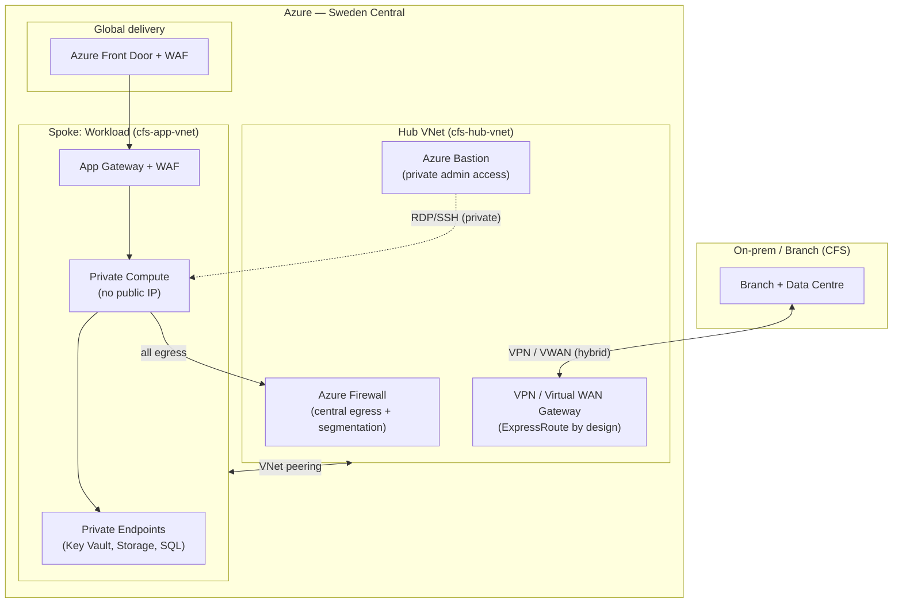

# Module B Networking Microhack — Train-the-Trainer

> A **1-day, classroom-led, hands-on microhack** that teaches partner network architects to
> deliver **all seven Module B controls** of the **Networking Services in Microsoft Azure
> Advanced Specialization** — by deploying a Microsoft best-practice **secure hub & spoke
> landing zone** with **private networking, isolated resources, and private compute**, driven
> end-to-end by **GitHub Copilot agents, skills, and MCP servers**.

[](https://NikoMix.github.io/microhack-networking-services/)
[-0078D4)](./infra/)
[](./LICENSE)

---

## Why this microhack

The Advanced Specialization audit is evidence-heavy. This microhack turns the audit's
**Module B** controls into a hands-on engagement: pupils use Copilot agents to **assess,
design, deploy, validate, and document** a secure Azure network for a fictional regulated
fintech — **Contoso Financial Services (CFS)** — and walk away with audit-ready evidence
and the ability to **re-teach the course**.

It demonstrates the latest capabilities — **GitHub Copilot custom agents**, **skills /
prompt files**, **Model Context Protocol (MCP) servers** (Azure + GitHub), **modular
inference** (GitHub Models / Azure OpenAI / Azure AI Foundry), and **GitHub Actions OIDC**
deployment — all focused on the Microsoft Azure networking stack.

## What gets deployed



**Native Azure networking services exercised (B.3.2 needs ≥ 5):** Virtual Network + VNet
Peering · Azure Firewall · VPN / Virtual WAN · Private Link / Private Endpoints · Load
Balancer · Application Gateway + WAF · Azure Front Door + WAF · (ExpressRoute by design).

## Challenge → control map

| # | Challenge | Module B control(s) |
| --- | --- | --- |
| 00 | Setup, tooling & the CFS brief | _foundation_ |
| 01 | Requirements Assessment | **B.1.1** |
| 02 | Solution Design + Well-Architected Review | **B.2.1 + B.2.2** |
| 03 | Deploy the Secure Hub & Spoke | **B.3.1 + B.3.2** |
| 04 | Private Networking, Isolation & Private Compute | **B.3.2** |
| 05 | Validation & Testing | **B.4.1** |
| 06 | As-Built, Operations & Teardown | **B.4.2** |

## Quick start (pupil)

1. **Open in Codespaces** → `Code ▸ Codespaces ▸ Create codespace on main`. The dev
   container installs Azure CLI + Bicep, Terraform, GitHub CLI, `azd`, Marp, and the docs site.
2. **Preview the labs**: `npm run dev` → open the forwarded port (4321).
3. **Authenticate to Azure** and start with **Challenge 00**.

> Full prerequisites, cost guardrails, and the inference-backend choices are on the
> [docs site](https://NikoMix.github.io/microhack-networking-services/prerequisites/).

## Repository structure

```text
.devcontainer/        Codespaces dev container (all CLIs pre-installed)
.github/
  agents/             GitHub Copilot custom agents (.agent.md)
  prompts/            Reusable skills / prompt files
  models/             Modular inference config (GitHub Models / AOAI / Foundry)
  workflows/          GitHub Actions: deploy (OIDC), teardown, validate, docs, CI
infra/
  bicep/              ALZ-accelerator hub & spoke + private networking + private compute
  terraform/          Terraform (AVM) alternate track
  scripts/            bootstrap, deploy, teardown, cost guardrails
src/content/docs/     Astro Starlight docs site (overview, challenges, trainer, solutions, reference)
slides/               Marp Train-the-Trainer deck
evidence-templates/   Module B evidence artifacts (xlsx/docx/pdf)
diagrams/             Reference architecture diagrams (drawio + svg + mermaid)
tools/                Validation scripts (link check, markdownlint, etc.)
```

## Built with (license-free)

Astro + Starlight · Bicep + Azure Verified Modules · Terraform + AVM · Marp · GitHub
Actions · GitHub Copilot agents/skills/MCP. No paid/licensed third-party components.

## Acknowledgements

Module B control definitions: [`NikoMix/specialization-networking-services`](https://github.com/NikoMix/specialization-networking-services).
Pattern inspiration: `microsoft/azure-trust-agents`, `jonathan-vella/apex`.

## License

[MIT](./LICENSE).
