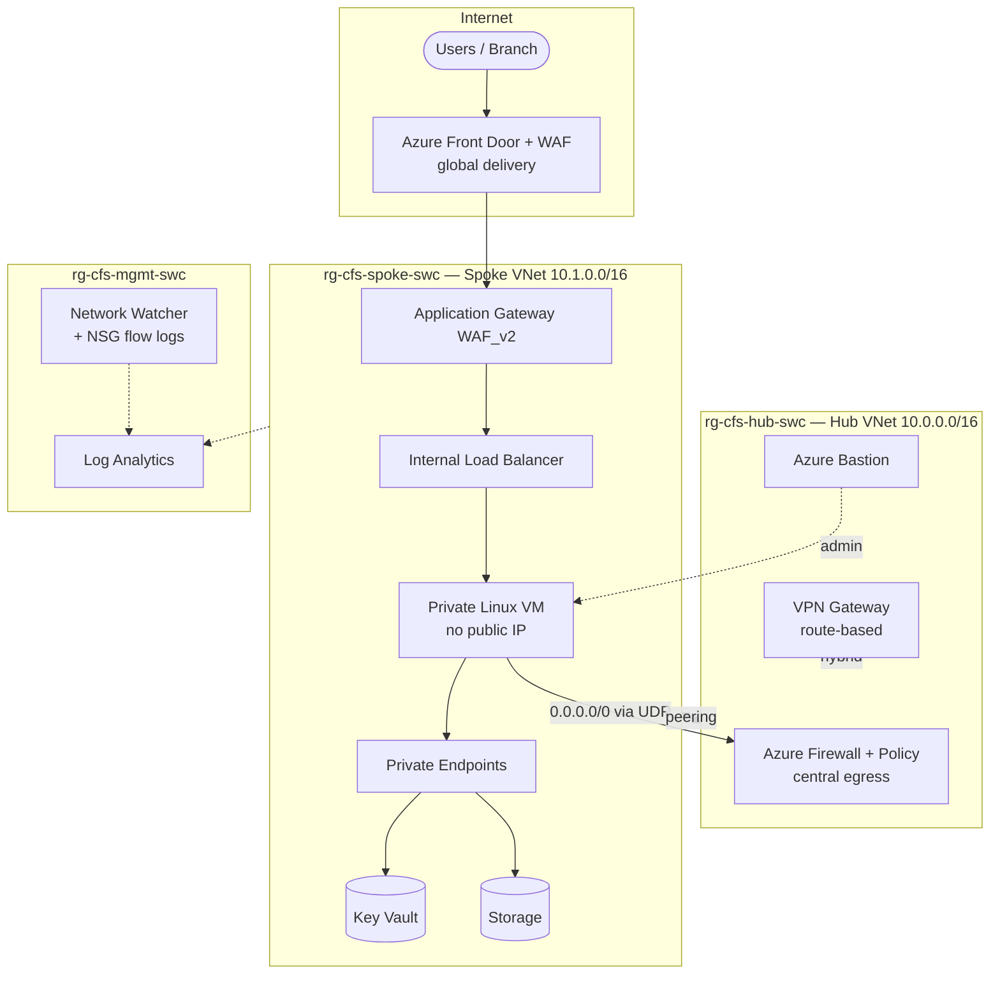

# CFS Secure Hub & Spoke Landing Zone (Module B IaC)

Infrastructure-as-Code for the **Networking Services in Microsoft Azure** advanced
specialization microhack. It deploys a Microsoft best-practice **hub & spoke** secure network
for the fictional regulated EU fintech **Contoso Financial Services (CFS)** into *each pupil's
own* Azure subscription, via **GitHub Actions with OIDC** (no secrets, no keys).

- **Bicep is primary** (`infra/bicep/`) using **Azure Verified Modules (AVM)**.
- **Terraform mirrors** the same topology (`infra/terraform/`) using AVM Terraform modules.
- Region **`swedencentral`** (fallback `westeurope`); naming `cfs-<role>-<type>-swc`;
  resource groups `rg-cfs-<tier>-swc`; tag `env=lab`.

> Maps to **B.3.1 Scenario Implementation** and **B.3.2 (≥5 native Azure networking services
> live)** — this build runs **9** native networking services (see the mapping below).

## Architecture



- **Private by default**: no public PaaS endpoints — Key Vault and Storage are reachable only
  through **Private Endpoints** with **Private DNS** zones. Compute has **no public IP**;
  admin access is via **Azure Bastion**.
- **Central egress**: all spoke egress is forced to **Azure Firewall** with a UDR
  (`0.0.0.0/0 → firewall private IP`).
- **Secure global delivery**: **Front Door + WAF** in front of **Application Gateway (WAF_v2)**,
  which load-balances to the private backend via an **internal Load Balancer**.
- **Hybrid**: a real **VPN Gateway** (route-based) is provisioned. **ExpressRoute is
  design-only** (see below).
- **Governance**: **Log Analytics**, **NSG flow logs**, **Network Watcher**, a **budget + email
  alerts**, and **Key Vault with purge protection ON**.

## B.3.2 service-to-control mapping

| # | Native Azure networking service | Where (Bicep / Terraform) | Scenario |
| - | --- | --- | --- |
| 1 | **Virtual Network** (hub + spoke) + **VNet Peering** | `hub-network.bicep`, `spoke-network.bicep`, `peering.bicep` / `network.tf` | #1 Secure infra |
| 2 | **Azure Firewall** (+ Firewall Policy, central egress) | `firewall.bicep` / `network.tf` | #1 |
| 3 | **VPN Gateway** (route-based, hybrid) | `vpn-gateway.bicep` / `security.tf` | #2 Connectivity |
| 4 | **Private Link / Private Endpoints** (+ Private DNS) | `key-vault.bicep`, `storage.bicep`, `private-dns.bicep` / `security.tf` | #1 |
| 5 | **Azure Bastion** (private admin) | `bastion.bicep` / `security.tf` | #1 |
| 6 | **Internal Load Balancer** | `load-balancer.bicep` / `delivery.tf` | #4 Delivery |
| 7 | **Application Gateway + WAF** (WAF_v2) | `app-gateway.bicep` / `delivery.tf` | #4 |
| 8 | **Azure Front Door + WAF** (global) | `front-door.bicep` / `delivery.tf` | #4 |
| 9 | **Network Watcher** (+ NSG flow logs) | `network-watcher.bicep` / `governance.tf` | #1 governance |

Nine native networking services — comfortably above the **≥5** required for **B.3.2** (target
was 7). Supporting platform services: **Log Analytics**, **Key Vault** (purge protection),
**Storage** (PaaS behind Private Link), **Consumption budget + alerts**.

## ExpressRoute — design-only (NOT provisioned)

A real ExpressRoute circuit incurs significant monthly cost and requires a connectivity
provider, so it is intentionally **not deployed**. For production CFS, the recommended design is:

- **ExpressRoute circuit** (provider-managed) terminating on an **ExpressRoute Gateway** in the
  hub `GatewaySubnet`, coexisting with the VPN Gateway for **active/active resilient hybrid**.
- **Private peering** for VNet traffic; **FastPath** for low-latency flows; **Global Reach** to
  link on-prem sites.
- Encryption via **MACsec** (circuit) and/or **IPsec over ExpressRoute** using the VPN Gateway.
- The hub topology and `GatewaySubnet` already accommodate adding the gateway with no redesign.

To migrate from VWAN to a Virtual WAN hub later, the AVM `avm-ptn-vnetgateway` /
`avm/res/network/vpn-gateway` modules map directly onto the same spokes.

## Prerequisites

- An Azure subscription you own (Owner, or Contributor + User Access Administrator).
- [Azure CLI](https://learn.microsoft.com/cli/azure/install-azure-cli) ≥ 2.60 with the Bicep
  CLI (`az bicep install`).
- [Terraform](https://developer.hashicorp.com/terraform/install) ≥ 1.9 (only for the mirror).
- A GitHub repo fork/clone to run the workflows.

## Wire GitHub → Azure (OIDC, no secrets)

Run the bootstrap once to create an Entra app + federated credential + RBAC, then add the
three **identifiers** it prints as GitHub Actions secrets. Full guide:
[`infra/scripts/OIDC-BOOTSTRAP.md`](scripts/OIDC-BOOTSTRAP.md).

```bash
./infra/scripts/oidc-bootstrap.sh --org <org> --repo <repo> --environment lab
# adds AZURE_CLIENT_ID, AZURE_TENANT_ID, AZURE_SUBSCRIPTION_ID
```

## Deploy

**Recommended — GitHub Actions** (`Deploy` workflow, `workflow_dispatch`): runs a what-if
preview, then deploys to the `lab` environment over OIDC. Set `whatIfOnly=true` for a dry run.

### Staged, gateway-first deploy (recommended for labs)

The VPN gateway takes **30–45 minutes**, so deploy it **first** and let it provision while you
stage the rest. The `component` input controls which slice deploys (the hub foundation —
Log Analytics, hub VNet, Azure Firewall — always deploys so every stage is self-consistent and
idempotent):

| `component` | Deploys | When |
| --- | --- | --- |
| `gateway` | hub VNet + **VPN gateway** (the long pole) | **run FIRST** |
| `hub` | + Bastion (firewall/hub network already on) | next |
| `spoke` | spoke VNet + peering + Private Link (KV/Storage) + private VM + internal LB + flow logs | next |
| `edge` | App Gateway + Front Door (+ spoke VNet for the AppGW subnet) | last |
| `all` | everything in one deployment (**default**) | single-shot |

```bash
gh workflow run deploy.yml -f component=gateway   # FIRST — kicks off the 30-45 min gateway
gh workflow run deploy.yml -f component=hub
gh workflow run deploy.yml -f component=spoke
gh workflow run deploy.yml -f component=edge
# or simply:
gh workflow run deploy.yml -f component=all
```

Each stage is an independent, idempotent ARM deployment, so re-running a stage (or `all` after
staging) is safe. Stages can overlap — start `gateway`, then run `spoke`/`edge` while the
gateway is still provisioning.

### Local — what-if first, always

```bash
# Bicep (primary)
./infra/scripts/deploy.sh --component gateway      # FIRST (or: all/hub/spoke/edge)
./infra/scripts/deploy.sh --what-if-only           # preview
./infra/scripts/deploy.sh                          # full deploy (component=all)

# PowerShell equivalent
./infra/scripts/deploy.ps1 -Component gateway
./infra/scripts/deploy.ps1 -WhatIfOnly
./infra/scripts/deploy.ps1
```

```bash
# Terraform (mirror)
cp infra/terraform/lab.tfvars.example infra/terraform/lab.tfvars   # edit values
terraform -chdir=infra/terraform init
terraform -chdir=infra/terraform plan  -var-file=lab.tfvars
terraform -chdir=infra/terraform apply -var-file=lab.tfvars
```

Provide an SSH **public** key (`adminSshPublicKey` / `admin_ssh_public_key`) to enable the
private VM — password auth is disabled. Leave it empty and the VM is skipped (Bicep) or a lab
key is generated and kept out of outputs (Terraform).

## Teardown

**GitHub Actions** — run the `Teardown` workflow and type `DELETE` to confirm. **Local:**

```bash
./infra/scripts/teardown.sh --confirm DELETE        # deletes the 3 CFS resource groups
./infra/scripts/teardown.ps1 -Confirm DELETE
# Terraform:
terraform -chdir=infra/terraform destroy -var-file=lab.tfvars
```

> Firewall and VPN Gateway deletes can take 10–20 minutes. Always tear down after a lab run.

## Cost guardrails

- The deployment creates a **Consumption budget** (default `200`/month) with **80% and 100%
  email alerts** when `budgetContactEmails` is supplied.
- Check spend and budget status any time:
  `./infra/scripts/cost-guardrail.sh` (or `.ps1`).
- The biggest cost drivers are the **VPN Gateway**, **Azure Firewall**, **Application Gateway**,
  and **Front Door**. Toggle `deployVpnGateway` / `deployFrontDoor` off for cheaper validation
  runs.

## Validation (CI gates — no live Azure needed)

The `Validate Infra` workflow runs on every PR/push to `infra/**`:

| Gate | Command |
| --- | --- |
| Bicep build + lint | `az bicep build --file infra/bicep/main.bicep` (0 warnings) |
| Terraform format | `terraform -chdir=infra/terraform fmt -check -recursive` |
| Terraform validate | `terraform -chdir=infra/terraform init -backend=false && validate` |
| Policy scan (license-free) | `checkov --framework bicep` and `--framework terraform` |

[**Checkov**](https://www.checkov.io/) (Apache-2.0) is installed **in CI only** — it is not a
repo dependency. Skips are documented in [`infra/.checkov.yaml`](.checkov.yaml). Because AVM
resources live in remote modules, the authoritative Bicep gate is `az bicep build` + the Bicep
linter; Checkov adds Terraform and supply-chain coverage.

## Security posture

- **OIDC only** — no client secrets, no storage/Key Vault keys committed or used.
- **Managed identity** on Azure-hosted resources; **shared key access disabled** on Storage;
  **RBAC** authorization on Key Vault with **purge protection ON** and **public access disabled**.
- **No public IPs** on compute; **Private Endpoints + Private DNS** for all sample PaaS.
- **WAF** on both Front Door and Application Gateway; **NSG flow logs** + **Network Watcher**
  + **Log Analytics** for full network observability.

## Layout

```
infra/
├── bicep/                 # PRIMARY — AVM modules
│   ├── main.bicep         # subscription-scoped orchestrator (creates 3 RGs)
│   ├── modules/           # 16 composable modules
│   └── parameters/lab.bicepparam
├── terraform/             # AVM Terraform mirror (same topology)
├── scripts/               # deploy / teardown / cost-guardrail (.ps1 + .sh) + OIDC bootstrap
└── .checkov.yaml          # CI policy-scan config (skips documented)
```
