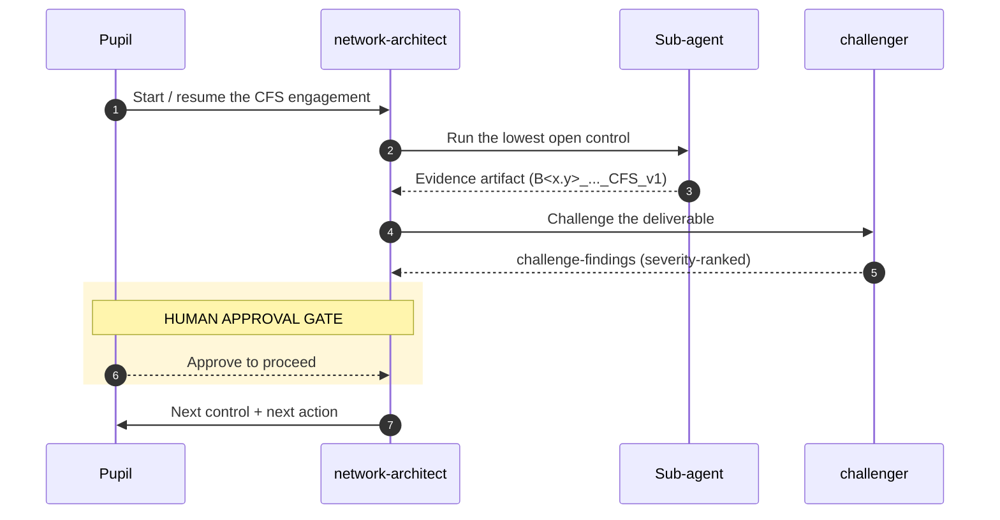

import { Aside, Steps, Card, CardGrid } from '@astrojs/starlight/components';

The microhack is delivered by a small team of **GitHub Copilot custom agents**
that mirror a real engagement: an **orchestrator** sequences specialist
**sub-agents**, a **challenger** red-teams every deliverable, and a human
**approves at every gate**. The agents reach your Azure subscription and this
GitHub repo through **MCP servers**.

<Aside type="note" title="AI prepares. Humans decide.">
Agents never cross an approval gate for you. At each control they summarise their
output, surface the challenger's findings, and wait for your explicit approval.
</Aside>

## The agents

| Agent | Role | Control(s) | Challenge |
|---|---|---|---|
| **network-architect** | Orchestrator — sequences the team, enforces gates | all | all |
| **requirements-analyst** | Cloud Networking Requirements Assessment | B.1.1 | 01 |
| **solution-designer** | Hub & spoke Solution Design (HLD) | B.2.1 | 02 |
| **waf-reviewer** | Well-Architected Review (≥2 pillars) | B.2.2 | 02 |
| **iac-engineer** | AVM-first IaC + OIDC deploy, ≥5 services | B.3.1 / B.3.2 | 03–04 |
| **validation-engineer** | Validation, testing & customer sign-off | B.4.1 | 05 |
| **evidence-author** | As-built docs, runbooks, evidence index | B.4.2 | 06 |
| **challenger** | Red-team / QA before every gate | cross-cutting | all |

Each agent file (`.github/agents/<name>.agent.md`) carries YAML frontmatter
(`name`, `description`, `tools`) and a rich system prompt tying it to its
control(s), the CFS scenario, and the AVM / OIDC / private-by-default standards.

## The orchestration flow

## Reusable skills

Agents call the prompt files in `.github/prompts/` so behaviour is consistent:

<CardGrid>
  <Card title="requirements-capture" icon="pencil">B.1.1 interview → testable requirements.</Card>
  <Card title="solution-design" icon="setting">B.2.1 HLD with AVM module selection.</Card>
  <Card title="waf-review" icon="approve-check">B.2.2 scored, pillar-based review.</Card>
  <Card title="networking-services-selection" icon="list-format">Prove B.3.2's ≥5 services.</Card>
  <Card title="what-if-review" icon="magnifier">Safe what-if / plan before deploy.</Card>
  <Card title="evidence-generation" icon="document">Named artifacts + evidence index.</Card>
  <Card title="teardown-checklist" icon="trash">Clean, verified, cost-safe teardown.</Card>
  <Card title="orchestration-kickoff" icon="rocket">Start/resume via the orchestrator.</Card>
</CardGrid>

## MCP servers

The agents connect to live systems through two **license-free** MCP servers,
configured in
[`.vscode/mcp.json`](https://github.com/NikoMix/microhack-networking-services/blob/main/.vscode/mcp.json):

- **Azure MCP** (`@azure/mcp`) — resource graph, what-if / deployment, pricing,
  documentation, best practices, Well-Architected, and Bicep/Terraform AVM
  tooling. Authenticates with `DefaultAzureCredential` (**keyless**).
- **GitHub MCP** — Issues (control tracking), pull requests, and Actions runs. In
  Codespaces the built-in `GITHUB_TOKEN` is used automatically.

<Steps>

1. Open the repo in a **Codespace** (or local VS Code with the dev container).

2. **Azure auth (keyless):** run `az login`; the Azure MCP server picks up your
   credential automatically. No keys are stored.

3. **GitHub auth:** Codespaces injects `GITHUB_TOKEN`. Locally, VS Code prompts
   for a PAT (`repo`, `read:org`, `workflow`) via the `github-pat` input — it is
   never written to disk in the config.

4. Confirm both servers are connected in the VS Code MCP view, then start with
   the **network-architect** agent.

</Steps>

<Aside type="tip" title="Model-agnostic">
Every agent runs on **GitHub Models** (default), **Azure OpenAI**, or **Azure AI
Foundry** with no edits — see [Modular inference](./modular-inference/). Keyless,
license-free, no image generation.
</Aside>
